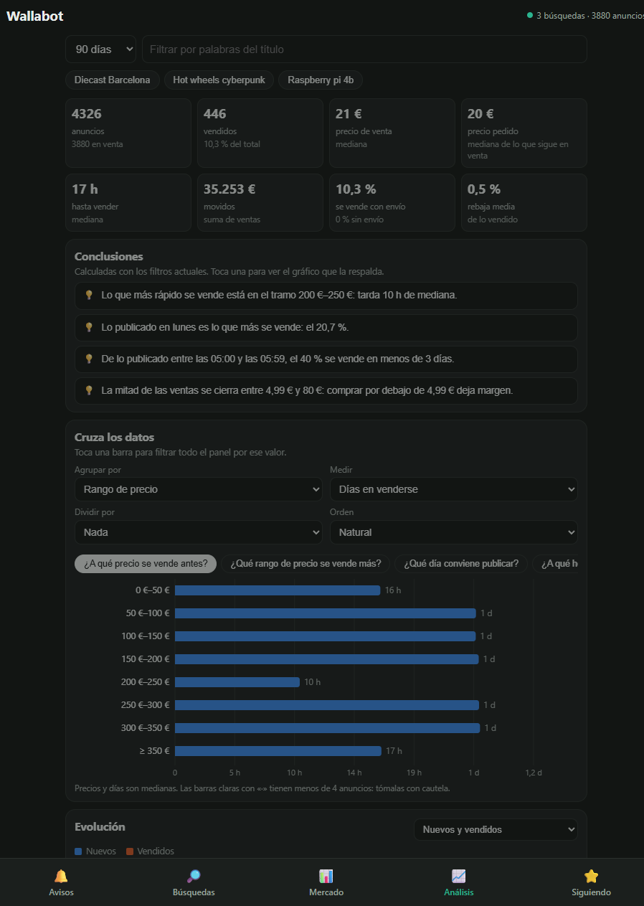
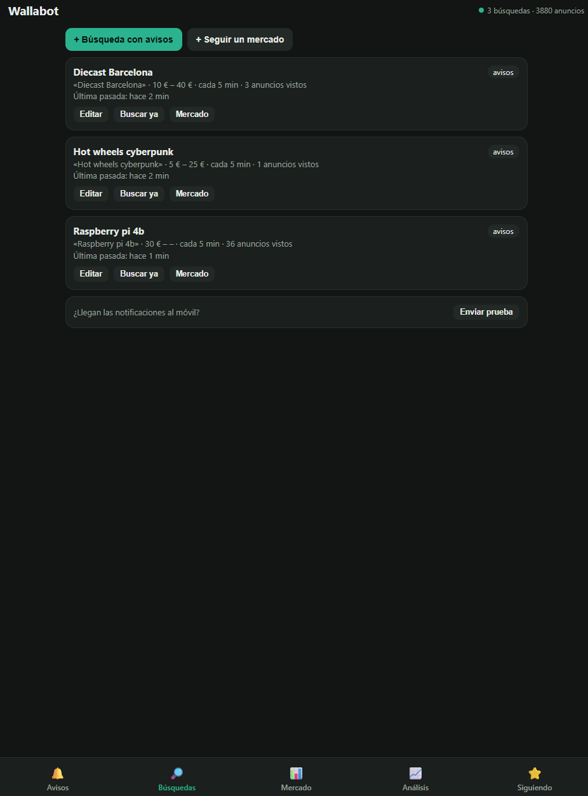

# Wallabot

Rastreador de **Wallapop** 24/7 con avisos en tiempo real y **análisis de mercado**. Un servidor en Python sigue búsquedas, detecta chollos, bajadas de precio y ventas, y notifica a una app Android propia mediante long-polling, sin servicios de terceros.

## Qué hace

- **Búsquedas con avisos**: anuncios nuevos, chollos (precio por debajo de la mediana de la búsqueda), bajadas de precio, reservados que se liberan y artículos republicados.
- **Señales de contexto**: detecta prisa del vendedor en la descripción ("urge", "mudanza"…) y riesgo en los chollos (cuenta nueva, sin valoraciones o precio anómalo).
- **Análisis de mercado**: guarda cada anuncio y revisa su ficha periódicamente para calcular qué se vende más, en cuántos días, precio pedido frente a precio real de venta y rebaja media.
- **Resumen diario** por búsqueda y alertas de estado (bloqueos, búsquedas sin resultados, servidor caído).
- **Avisos por canales**: cada tipo de aviso tiene su canal de Android para personalizar sonido y prioridad.

## Capturas

<table>
  <tr>
    <td align="center"></td>
    <td align="center"></td>
    <td align="center"></td>
  </tr>
  <tr>
    <td align="center">Chollos</td>
    <td align="center">Análisis de mercado</td>
    <td align="center">Búsquedas</td>
  </tr>
</table>

## Arquitectura

```
 Wallapop  ◄── búsquedas y fichas públicas ──  Servidor Python (Raspberry Pi)
                                                ├─ rastreador asíncrono + SQLite
                                                ├─ análisis de mercado
                                                ├─ panel web
                                                └─ /api/events (long-poll)
                                                       ▲
                                        Tailscale      │
                                                       │
                                                App Android (Kotlin)
```

No usa ninguna cuenta de Wallapop: solo consulta información pública, con pausas entre peticiones.

## Tecnologías

- **Backend**: Python 3 asíncrono con Starlette, Uvicorn y httpx; SQLite.
- **API**: REST con autenticación por token y long-polling para eventos en tiempo real.
- **Frontend**: panel web en HTML y JavaScript con gráficas.
- **App**: Android nativo en Kotlin, servicio en primer plano y canales de notificación.
- **Tests**: `unittest`.
- **CI/CD**: GitHub Actions compila la APK y la publica en Releases al etiquetar versiones.
- **Infraestructura**: Raspberry Pi, servicio `systemd`, Tailscale.

## Estructura

```
server/wallabot/
  tracker.py    rastreo de búsquedas y fichas
  market.py     estadísticas de mercado
  wallapop.py   cliente de Wallapop
  web.py        API y eventos
  static/       panel web
server/tests/
android/        app Android
deploy/         instalador y servicio systemd
```

## Puesta en marcha

```bash
bash deploy/install.sh   # instala dependencias, crea el servicio y genera el token
```

La guía completa está en [INSTALACION.md](INSTALACION.md).
